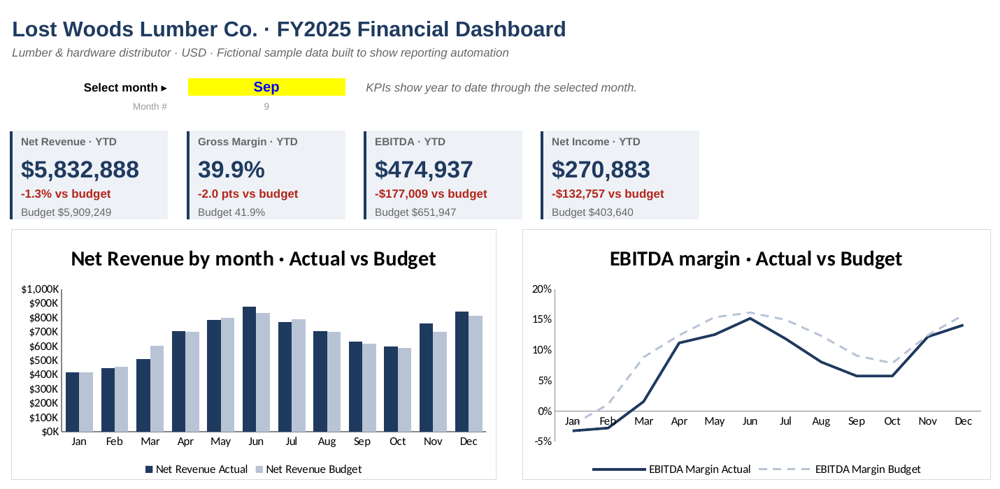

# Finance Portfolio

Sample work on the problems I solve most often: turning raw financial data into reports people can actually use, and cleaning the messy exports that get in the way.

Every company, number and transaction here is fictional. The client is **Lost Woods Lumber Co.**, a made-up lumber and hardware distributor.

---

## 1. P&L dashboard with budget vs actual

A full FY2025 income statement built straight from 2,151 transactions, with a budget comparison and a one-click dashboard. Pick a month in the yellow cell and every KPI, variance and chart updates year to date.

**What's inside**

- Monthly P&L from revenue down to net income, all `SUMIFS` from the transaction table
- Budget vs actual by line, for the month and year to date, flagged favorable or unfavorable
- Dashboard with revenue, gross margin, EBITDA and net income against budget
- Transaction data in long format, the way an accounting system exports it

**The story in the numbers:** revenue lands 1.3% under budget, mostly from a weak March. Gross margin slips 2 points after a supplier price increase in July and expensive freight during port delays in August and September. A Q2 marketing push ran over plan. Net effect: EBITDA $177K behind budget through September.

📄 [Lost_Woods_PL_Dashboard_FY2025.xlsx](Lost_Woods_PL_Dashboard_FY2025.xlsx)

---

## 2. Accounts payable cleanup with Python in Excel

A raw AP export from an old system: duplicated invoices, the same vendor spelled 38 different ways, six date formats in one column, amounts stored as text, and subtotals dropped in the middle of the data. I cleaned it step by step with Python inside Excel (pandas), so every step stays visible and reruns if the export changes.

| Check | Before | After |
| --- | ---: | ---: |
| Total rows | 609 | 560 |
| Non-invoice rows (blanks, subtotals, footer) | 17 | 0 |
| Duplicate invoices | 32 | 0 |
| Vendor name variants | 38 | 8 |
| Category labels | 20 | 6 |
| Missing categories | 32 | 0 |
| Status labels | 12 | 3 |
| Amounts stored as text | 420 | 0 |

A few choices worth calling out:

- **Vendors** are matched on a simplified key, so "Pacific Freight Lines, Inc." and "PACIFIC FREIGHT LINES INC" land on the same official name. Anything unknown is flagged instead of guessed.
- **Categories** come from the vendor master, not the free-text column. Every vendor belongs to one category, so the blanks and typos disappear in one move.
- **Dates** are validated against the business: after parsing, every invoice has 15, 30 or 45 day terms, exactly what each vendor type should have.

📄 [Lost_Woods_AP_Cleanup_Python_in_Excel.xlsx](Lost_Woods_AP_Cleanup_Python_in_Excel.xlsx) · the `Clean` tab walks through each step

> Python in Excel needs Microsoft 365. Without it the Python cells won't recalculate, but the cleaned table and the quality report are still readable.

---

## Tools

Excel · Python in Excel (pandas) · SUMIFS and named ranges · Google Sheets & Apps Script · SQL

Built by [Alexander Batista](https://github.com/abatistat) · Financial data analyst · Panama City
